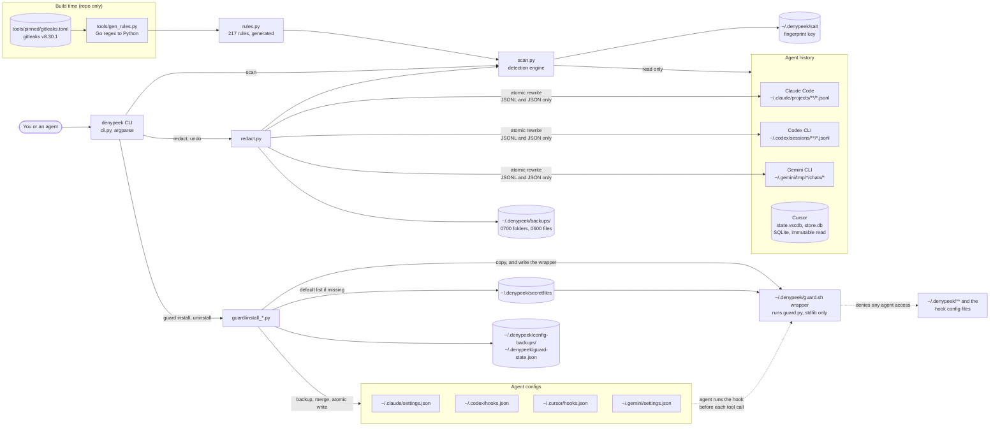
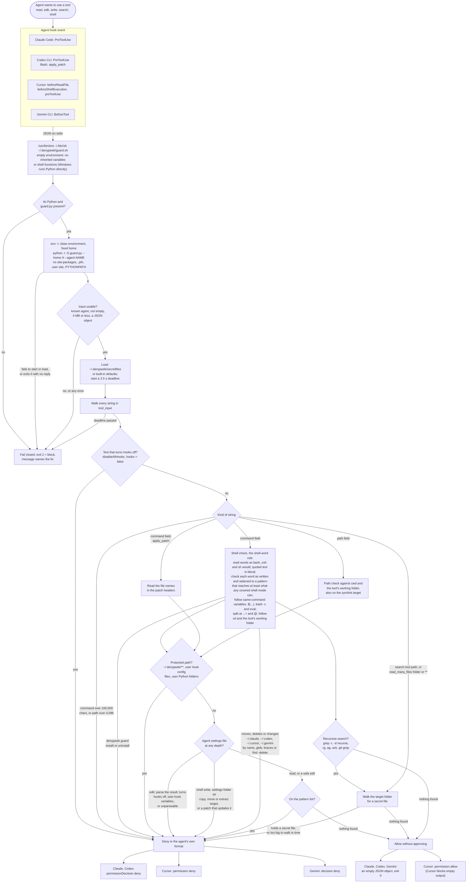
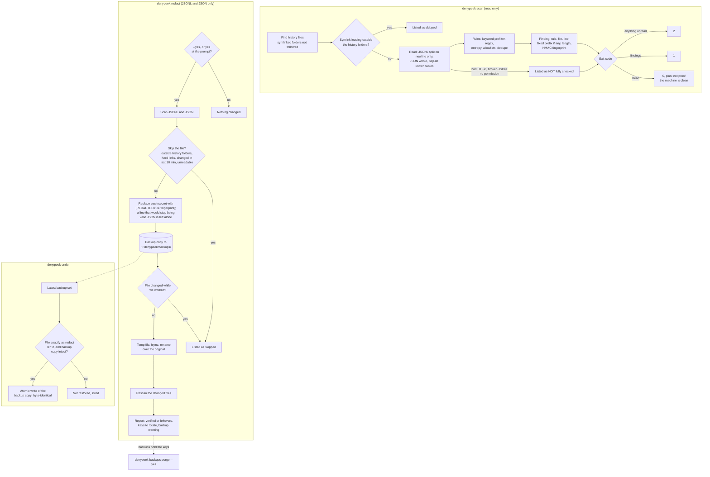

# denypeek

[](https://github.com/Sparli/denypeek/actions/workflows/ci.yml)

[](LICENSE)

**Keep API keys out of your coding agents: block secret-file reads in Claude Code, Codex CLI,
Cursor and Gemini CLI, then find and scrub the keys that already leaked into their history.**

Maya is a freelance developer (made up for this example). Three weeks ago she pasted a GitHub
token into Claude Code to fix a failing deploy. Last week a Codex session ran `cat` on her AWS
config while debugging, and the output landed in its log. Yesterday Cursor's agent opened her
`.env` to "check the Stripe settings". Those keys now sit in plain text in four places on her
laptop, in files she has never opened:

```
~/.claude/projects/-home-maya-shop-api/7f3c.jsonl            line 2   a GitHub token
~/.codex/sessions/2026/11/12/rollout-…jsonl                  line 3   an AWS access key
~/.gemini/tmp/5b1e/chats/session-2026-11-10.json             line 9   a Stripe live key
~/Library/Application Support/Cursor/…/state.vscdb           row 1    a Slack bot token
```

`denypeek scan` finds them without printing them. `denypeek redact` replaces them with markers,
keeps a backup and proves the result with a rescan. `denypeek guard install` stops the next
`.env` read, in all four agents, from one pattern list.

> **Status: v0.1.0, not released.** Guard, scan, redact and undo work and are tested on fixture
> homes on macOS and Linux. **Windows support for the guard is experimental**: it passes CI on
> Windows on fixtures, but the clean-environment wrapper and its tests are POSIX-only, and a
> missing hook Python fails open there. **None of the four
> agents is live-tested yet**: the hooks follow each vendor's documented format, but nobody has
> run them inside a real Claude Code, Codex CLI,
> Cursor or Gemini CLI session. Not on PyPI. Detection is best effort: a clean scan is not proof
> that a machine is clean.

**What the guard is, and is not.** It stops accidental and straightforward reads of secret files
by coding agents: the `cat .env`, the "let me check your config", the recursive grep that sweeps
up a key. It is a best-effort filter on the tool calls an agent makes, and it tries hard to
resist common tricks. It is **not a sandbox**: an agent that is determined to get round it can
(see [Known misses](#limitations-honest)). For that, run the agent inside OS-level isolation,
such as a container, a separate user account, or the agent's own sandbox mode, with your secrets
outside it.

**The design constraint: nothing leaves your machine.** denypeek has no run-time dependencies and
no network code. It never prints, logs or stores a full secret. The guard is one file of
standard-library Python that each agent runs before a tool call.

## Contents

- [How it works](#how-it-works)
- [Quickstart](#quickstart)
- [Commands](#commands)
- [The guard in each agent](#the-guard-in-each-agent)
- [Scan, rules and redaction](#scan-rules-and-redaction)
- [Design decisions](#design-decisions)
- [Failure modes](#failure-modes)
- [Limitations (honest)](#limitations-honest)
- [Ceilings and upgrade paths](#ceilings-and-upgrade-paths)
- [Roadmap](#roadmap)
- [Use from an agent](#use-from-an-agent)
- [Development](#development)
- [About this project](#about-this-project)

## How it works

### Architecture

<!-- diagram:01-architecture-overview -->

<!-- /diagram -->

**Three jobs share one detection engine and one pattern list, and every write goes through a
backup first.** `scan` only reads. `redact` and `guard install` are the only commands that write
outside `~/.denypeek/`, and both keep a copy of what they change.

| Part | File | Job |
|---|---|---|
| CLI | `src/denypeek/cli.py` | Parses commands with `argparse`. |
| Rules | `src/denypeek/rules.py` | 217 detection rules, generated from gitleaks by `tools/gen_rules.py`. |
| Scanner | `src/denypeek/scan.py`, `sources/` | Finds history files per agent and matches the rules. |
| Redaction | `src/denypeek/redact.py`, `backups.py` | Rewrites JSONL and JSON history, backs up, verifies, undoes. |
| Guard hook | `src/denypeek/guard/guard.py` | The script each agent runs before a tool call. |
| Installers | `src/denypeek/guard/install_*.py` | Edit each agent's config, one module per agent. |

### The guard path

<!-- diagram:02-guard-flow -->

<!-- /diagram -->

How a blocked `.env` read works:

1. **The agent fires its hook.** Before a tool call, the agent runs
   `/usr/bin/env -i /bin/sh ~/.denypeek/guard.sh --agent NAME` (on Windows, the Python command
   directly) and writes the call to its stdin as JSON. `env -i` comes first, so the shell that
   runs the wrapper starts with an empty environment: no variable or exported shell function
   (`BASH_FUNC_*`) an agent might set can change it. The event differs per agent: `PreToolUse` in Claude Code and
   Codex CLI, `beforeReadFile`, `beforeShellExecution` and `preToolUse` in Cursor, `BeforeTool` in
   Gemini CLI.
2. **The wrapper makes sure the hook can run, and runs it isolated.** It starts Python through
   `env -i` with a fixed, minimal environment (the home folder written at install time,
   `PATH=/usr/bin:/bin`), so nothing an agent might set, such as `PYTHONPATH`, `HOME` or
   `DEVELOPER_DIR`, reaches the hook. Python runs with `-I -S`, so no `site-packages`, `.pth`
   file, user `usercustomize.py` or script-folder module can change what the hook does, and the
   hook takes its home folder from the command line or the system account record, never from
   `HOME`. If the hook's Python or `guard.py` is missing, if Python fails, or if it exits without
   a reply, `guard.sh` exits 2, which every supported agent reads as "block".
3. **The guard checks the input itself.** Unknown agent, empty input, input over 4 MB, broken
   JSON, or anything that raises: the guard denies, exits 2, and names `denypeek guard uninstall`.
   The whole decision has a 2.5-second deadline; past it, the call is denied ("took too long to
   check"), and a watchdog makes sure of that even if the check itself gets stuck.
4. **It loads the pattern list.** `~/.denypeek/secretfiles`, or the built-in defaults when that file
   is missing.
5. **It looks at every string in the tool input**, so it does not depend on each agent's field
   names. A `command` field gets the shell check, an `apply_patch` gets its file headers read,
   and path fields get the path check, against the session folder and any working folder the
   tool names (`workdir`, `dir_path`...). A command over 100,000 characters or a path over 4,096
   is denied as too long to check, never skipped.
6. **The shell check reads words the way the shell does: the shell-word rule.** If bash, zsh or
   sh can expand an argument word to a protected path, the command is denied. Covered modes,
   alone or combined, whether set earlier or by the command itself: bash and sh defaults; bash
   `extglob`, `globstar`, `dotglob`, `nocaseglob`; zsh defaults; zsh `extendedglob`, `kshglob`,
   `globdots`, `nocaseglob`, `globstarshort`. The check may deny more than the shell would
   reach, never less:
   - `*`, `?` and bracket expressions keep their meaning. Letter case never counts, and `**`
     matches at any depth.
   - Hidden names (those starting with `.`) depend on a setting, `hidden_names`, which
     `denypeek guard install` sets and prints. **`always`, the default:** hidden names always
     count. **`auto`, experimental in v0.1.0, chosen with `guard install --hidden auto`:** a `*`,
     `?` or bracket at the start of a path part does not match a hidden name, as in bash, zsh
     and sh without `dotglob`, `globdots` or `GLOBIGNORE`; so `cat *` passes beside a `.env`.
     With `--hidden auto`, install still reads your bash and zsh startup files (yours and the
     system's) and sets `always` when one of them names `dotglob`, `globdots` or `GLOBIGNORE`;
     `guard status` checks again and says so if that has changed. A later plain `guard install`
     keeps the setting you chose. In `auto`, widened text and an expansion the guard cannot
     resolve (`cat $x*`) still count hidden names, and the commands the guard knows to turn
     hidden-name matching on are denied: `shopt -s dotglob`, `setopt globdots`, `zsh -4`,
     `shopt -s $o`, or setting a variable whose name is not written out
     (`declare ${n}IGNORE=x`). Some forms get through (see Known misses). A missing or unknown
     setting means `always`, and Windows is always `always`.
   - Any other pattern syntax a covered mode can read (`(…)`, `#`, `^`, `x~y`, `<1-9>`, `@(…)`,
     `{....}`) widens the rest of that path part to "anything". If it could reach past a `/`, it
     widens to everything under that point.
   - Quoted text is literal when it reaches a program as an argument, so `echo '*'`,
     `grep -o '[a-z]*' README.md` and `find . -name '*.py'` pass. It is a live pattern again
     when the same command lets a shell read it again:
     - bound, then used unquoted: an assignment (`a='[!x]'; cat .en$a`), an array element, a
       `for … in` list, `set --`, and the arguments after a `-c` script;
     - parsed again: the string after `-c` for sh, bash, zsh, dash or ksh (also behind
       `sudo`, `env`, `timeout`, `xargs` or `find -exec`), every argument of `eval`, a
       here-string to a shell, and the strings in a pipeline that ends in a shell
       (`echo 'cat .e*' | sh`).
   - Each word is checked as written and as widened.
   - Also followed:
     - quoting: `$'...'`;
     - home and folder forms: `~`, `~+`, `$HOME`, `$PWD`;
     - splitting: `$IFS`, braces and `{m..o}` sequences;
     - variables given a literal value in the same command;
     - nested commands: `$(…)`, backticks, `<(…)`, and scripts given to `sh -c`, `bash -c`,
       `zsh -c` or `eval`;
     - redirections and line continuations;
     - words after `:`, `=` and `@` (`git show HEAD:.env`, `curl -F f=@.env`);
     - folders entered with `cd`;
     - Windows paths and home variables (`C:\proj\.env`, `%USERPROFILE%`).
   - Real bash, zsh and sh check this in CI: the glob oracle in `tests/oracle` expands thousands
     of generated words in every covered mode. The `.` and `..` cases are proved on macOS only,
     because bash 3.2 exists only there; dash (Linux `/bin/sh`) is untested until the first
     Linux CI run. Agent-run `denypeek guard install` and `uninstall` are denied.
7. **The guard protects itself.** Any agent access to `~/.denypeek/**`, to the user-level hook
   config files and to your per-user Python folders is denied, whatever the pattern list says.
   Commands may list or read `~/.claude`, `~/.codex`, `~/.cursor` and `~/.gemini` but not move,
   delete or change them, also when named through a glob, braces or a `find -delete` from the
   home folder. Deleting, moving or locking your home folder or a folder above it is denied too,
   because that would remove `~/.denypeek` and every agent folder at once: a simple command
   holding `rm`, `rmdir`, `unlink`, `shred`, `srm`, `trash`, `chmod`, `chown`, `chgrp` or
   `chflags` (also after `sudo` or `env`, or as `/bin/rm` or `\rm`) with an operand that names
   such a folder (`..`, `.?`, `~`, `$HOME`); `mv` with such a folder as a source; `rsync` with a
   `--del…` flag or `--remove-source-files`; `git clean` there; `find -delete` from there; and
   an agent's own delete or move tool. `mv notes.txt ~`, `cp x ~`, `ls ..`, `cd ~ && ls` and
   `chmod +x ~/bin/tool` stay allowed.
   Agent settings files inside projects may be read and edited with the agent's
   file tools, but an edit is checked by parsing the file it would produce: one that turns hooks
   off (`disableAllHooks`, Codex `hooks = false`, Gemini `hooksConfig.enabled: false`), sets an
   `env` variable that could change how the hook or the agent's shell runs (`PYTHON*`, `HOME`,
   `PATH`, `DEVELOPER_DIR`, `LD_*`, `DYLD_*`, `BASH_FUNC_*`, `BASH_ENV`, `ENV`, `SHELLOPTS`,
   `IFS` and similar), or cannot be parsed is denied. Shell commands
   may read those files but may not write them, and may not use a project `.claude`, `.codex`,
   `.gemini` or `.cursor` folder itself as the source or target of a copy, move, link or
   extraction. Text containing `disableAllHooks` or `hooks = false` (also JSON-escaped) is denied
   anywhere as a second line. You change all of this in your own terminal, where no hook runs.
8. **Recursive searches are judged by what they can read: the tree rule.** For `grep -r` and
   `-d recurse`, `rg`, `ag`, `ack`, `git grep`, the agents' own search tools and Gemini's
   `read_many_files`, the guard walks the target folder by names and asks whether the tool, run
   as written, would read a secret file there:
   - `grep -r` and `ack` read everything (only `.git` and `__pycache__` are left out). grep's
     own `--include`, `--exclude` and `--exclude-dir` count. A search tool not on this list is
     not checked.
   - `rg` with no widening flag skips every hidden name, so `rg foo` beside `.env` is allowed.
     `rg --hidden`, `ag`, `git grep` and the agents' own search tools read hidden names.
   - Inside a git repository, those tools also skip a `node_modules` folder that a `.gitignore`
     names in a plain line (`node_modules`, `node_modules/`, `/node_modules`), and a folder whose
     own `.gitignore` is exactly `*` (virtualenvs write one). Outside a repository, ripgrep does
     not read `.gitignore`, so nothing is skipped.
   - The guard trusts an ignore file only when it is certain. If any ignore source the tools
     read holds a `!` line (which can bring a file back), or cannot be read in full, nothing is
     skipped, hidden names included. That covers `.gitignore`, `.ignore` and `.rgignore` in every
     folder walked and above, `.git/info/exclude`, git's global ignore file
     (`~/.config/git/ignore`), and any `core.excludesFile` or `include` in git's configuration.
     A command that names one of these files or git's configuration counts as reading
     everything, since it may change them before it searches.
   - Wrapper commands (`env`, `nice`, `timeout`, `command`, `sudo` and similar) and `cd` do not
     hide a search. A recursive search fed by `xargs`, and `git grep` with a revision or a
     pattern path, are denied: the guard cannot list what they read. A command that defines a
     function or an alias counts as reading everything.
   - A flag that widens the tool (`rg -uu`, `--no-ignore`, `-g '*'`, `git grep --no-index`) or a
     ripgrep config file counts as reading everything. `guard install` records whether
     `RIPGREP_CONFIG_PATH` is set; if it was, or if nothing is recorded, every `rg` counts so.
   - A search that covers your home folder or a folder above denypeek's or an agent's folder is
     denied at once. A walk of more than 100,000 entries, or longer than a second, is denied as
     too big to check.
9. **The answer goes back in the agent's own format.** A deny carries a reason the agent shows.
   An allow is an empty JSON object with no decision (Cursor gets an explicit `allow`, because it
   blocks empty output), so the
   agent's own permission prompts still apply.

### Scan, redact and undo

<!-- diagram:03-scan-redact-flow -->

<!-- /diagram -->

## Quickstart

You need Python 3.9 or newer and [uv](https://docs.astral.sh/uv/getting-started/installation/).

```bash
git clone https://github.com/Sparli/denypeek.git && cd denypeek
```

Install it as a command, so `denypeek` is on your PATH (the skill, the `AGENTS.md` snippet and
denypeek's own messages all use the bare `denypeek` command):

```bash
uv tool install .
```

If your shell cannot find `denypeek` afterwards, run `uv tool update-shell` once and open a new
terminal. To try it without installing, put `uv run` in front of each command below instead.

```bash
denypeek scan
```

That is a read-only scan of your agent history. Exit code 0 means nothing found, 1 means
findings, 2 means something could not be read or the scan was stopped. It first says how many
files and how much data it will read, then shows a progress line (store, file count, data read,
findings so far). A large history (several GB) takes a few minutes; it uses every CPU core. Ctrl-C
stops it cleanly and still lists what it found so far, marked incomplete.

Block secret-file reads in your agents, then prove the hook works:

```bash
denypeek guard install
```

```bash
denypeek guard test
```

**Hidden files, the default.** The guard counts hidden files such as `.env` for every pattern
(the setting `always`). The cost: in a folder that holds a hidden secret file, a command with a
bare `*`, such as `cat *`, `ls *` or `rm -rf ./*`, is denied. Name the files instead: `ls`,
`cat *.md`, `rm -rf build/`. The agent is told the same when this rule denies a call.
`denypeek guard install --hidden auto` lets a bare `*` skip hidden
files, as your shell does. It is experimental in v0.1.0 and has known gaps (see
[Limitations](#limitations-honest)).

To install a reviewed release without cloning, pin its tag (works once v0.1.0 is tagged and the
repository is public; the same command was tested against a local clone):

```bash
uv tool install git+https://github.com/Sparli/denypeek@v0.1.0
```

Once denypeek is on PyPI, `uvx denypeek scan` will also work.

**Installed the pre-release under its old name, keyhush?** Remove it first, in your own terminal
(an agent cannot do it; the old guard blocks that): run `keyhush guard uninstall`, then
`keyhush backups purge --yes` if you used redact. denypeek does not see or remove the old guard.

### Example run

Real output from `tools/capture_demo.py`, which builds a throwaway home folder under `/tmp` with
fake keys made at run time and runs the commands against it
([plain text](docs/assets/demo-run.txt)):


## Commands

| Command | What it does |
|---|---|
| `denypeek scan [--json]` | Read-only scan of agent history. Shows rule, file, line, length and a fingerprint, plus up to four characters of a fixed public prefix such as `AKIA` (none for rules without one, such as `generic-api-key`). |
| `denypeek redact [--yes] [--include-active]` | Replaces each found key with `[REDACTED:<rule>:<fingerprint>]` in JSONL and JSON history, after a backup. Then rescans. |
| `denypeek undo [--set NAME]` | Restores the files changed by the last redact, byte for byte. |
| `denypeek backups list` / `purge --yes` | Lists or deletes redact backups. They still hold the keys. `purge --config` deletes the copies of agent settings that `guard install` made instead. |
| `denypeek guard install [--agent NAME] [--hidden always\|auto]` | Wires the guard into each agent's own pre-tool hook, and sets and prints the hidden-names setting: `always` by default; `--hidden auto` is experimental. A later install keeps the setting you chose. |
| `denypeek guard status [--json]` | Shows where it is installed, checks the hook's Python exists and whether your account can modify it, and runs the hook once per agent. Exit 0 only if every asked-for agent is covered and working. |
| `denypeek guard test` | Feeds each agent's real hook input format to the installed hook and prints blocked or allowed, per agent and case. |
| `denypeek guard uninstall [--agent NAME]` | Removes only denypeek's entries. Run it in your own terminal: the guard denies it when an agent tries. |

Every command takes `--home DIR` to work on another home folder (used for testing).

## The guard in each agent

`guard install` copies `guard.py` to `~/.denypeek/`, writes the `guard.sh` wrapper beside it,
writes a default pattern list to `~/.denypeek/secretfiles` if there is none, and adds a hook entry
to each agent. Before each edit it backs the file up to `~/.denypeek/config-backups/`. It merges
without touching your other settings, writes atomically, and can run twice without duplicates. A
config file that is malformed, too big, oddly typed or read-only, or sits in a folder it cannot
write to, is left untouched and reported. `uninstall` removes only denypeek's own hook entries,
even inside a group you added hooks to.

**Your config file's layout changes.** denypeek writes the file back as standard JSON with
two-space indentation, so your spacing is not kept, and if the file had the same key twice only
the last one remains. A file with comments is not valid JSON, so denypeek leaves it untouched and
says so. Nothing of yours is lost otherwise, and the
original is in `~/.denypeek/config-backups/` (delete those copies with
`denypeek backups purge --config --yes`).

**Which Python runs the hook.** `guard install` prefers a Python your user account cannot
modify: first `/usr/bin/python3` (root-owned; on macOS it is protected by the system), then other
system Pythons, the Python your virtual environment was built from, and `python3` on your PATH. It
skips any Python inside a virtual environment or a temporary folder, such as a cloned repo's
`.venv`, because deleting that folder would break the guard. A Python whose program file or
standard library your account can write to (python.org and Homebrew installs often are) is used
only if nothing better exists, with a warning, because an agent allowed to write there could make
the hook allow everything. `guard status` repeats that warning. `--python PATH` picks one
yourself.

| Agent | File it edits | Hook | Notes |
|---|---|---|---|
| Claude Code | `~/.claude/settings.json` | `PreToolUse` for `Read\|Edit\|Write\|Grep\|Glob\|Bash\|PowerShell`, plus `permissions.deny` `Read(...)` rules | Deny rules also cover `@` mentions, which skip hooks. [Hooks](https://code.claude.com/docs/en/hooks), [permissions](https://code.claude.com/docs/en/permissions) |
| Codex CLI | `~/.codex/hooks.json` | `PreToolUse` for `Bash\|apply_patch` | **Run `/hooks` in Codex and trust the hook. Codex skips it until you do.** Hooks are on by default; if you turned them off, set `[features] hooks = true` in `~/.codex/config.toml`. [Docs](https://learn.chatgpt.com/docs/hooks) |
| Cursor | `~/.cursor/hooks.json` | `beforeReadFile`, `beforeShellExecution`, and `preToolUse` for `Read\|Write\|Grep\|Delete\|Shell`, all with `failClosed: true` | [Docs](https://cursor.com/docs/hooks) |
| Gemini CLI | `~/.gemini/settings.json` | `BeforeTool` for its file, search and shell tools | [Docs](https://geminicli.com/docs/hooks/reference/) |

### The pattern list

`~/.denypeek/secretfiles` uses gitignore-style lines. Case does not matter. A name with no slash
matches at any depth, `~/` means your home folder, and `!` allows a path again. The defaults
include `.env`, `.env.*` (but not `.env.example`, `.env.sample` or `.env.template`),
`.dev.vars`, `*.pem`, `*.key`, `id_rsa*` and other SSH keys (not `*.pub`), `.netrc`, `.npmrc`,
`.pypirc`, `credentials.json`, `~/.aws/credentials`, `~/.ssh/**`, `~/.docker/config.json`,
`~/.kube/config` and `~/.config/gcloud/**`. Public keys (`*.pub`) are allowed everywhere, also
inside `~/.ssh`; the rest of `~/.ssh` stays protected. Edit the file, then run
`denypeek guard test`.

## Scan, rules and redaction

### What scan reads

| Agent | Where | Format | Source of the path |
|---|---|---|---|
| Claude Code | `~/.claude/projects/**/*.jsonl` (or `$CLAUDE_CONFIG_DIR`) | JSONL | [Official docs](https://code.claude.com/docs/en/claude-directory) |
| Claude Code | `~/.claude/history.jsonl` | JSONL | **[unverified]** community sources |
| Codex CLI | `~/.codex/sessions/**`, `archived_sessions/`, `history.jsonl` (or `$CODEX_HOME`) | JSONL | **[unverified]** community sources |
| Gemini CLI | `~/.gemini/tmp/*/chats/*`, `logs.json` | JSONL, JSON | **[unverified]** community sources |
| Cursor | `state.vscdb` under Cursor's app folder (macOS, Linux, Windows), `~/.cursor/chats/**/store.db` | SQLite, read-only | **[unverified]** community sources |

Cursor's database is opened in immutable read-only mode: no locks, no journal, and the `-wal` file
is never opened. That mode does not see recent changes still in Cursor's `-wal` file, so if that
file is not empty the database is listed as not fully scanned (exit code 2). Close Cursor, which
folds those changes into the main file, and scan again. Every file or line that could not be read (broken JSON, bad UTF-8, no
permission) is listed, and the exit code is 2. A line holding a U+2028 character is read as one
line, not split, and noted. Fingerprints are a keyed hash with a random per-machine salt in
`~/.denypeek/salt`, so a short key cannot be worked back from its fingerprint.

### Detection rules

The rules come from [gitleaks](https://github.com/gitleaks/gitleaks/blob/v8.30.1/config/gitleaks.toml)
v8.30.1 (MIT), converted to Python by `tools/gen_rules.py`, with gitleaks' keywords, entropy
thresholds and allowlists kept. 217 of its 222 rules are used. 26 were rewritten from Go-only
regex syntax. These 5 are not used, because they match on the file's name or type, which does not
apply to agent history:

- `pkcs12-file` (matches file names only)
- `freemius-secret-key`, `hashicorp-tf-password`, `kubernetes-secret-yaml`,
  `nuget-config-password` (only apply to certain file types)

### Redaction, undo and backups

`redact` works on JSONL and JSON history only, never on Cursor's database.

- It asks first (or takes `--yes`) and never runs without confirmation in a non-interactive shell.
- It backs up each file to `~/.denypeek/backups/<time>-<id>/`. Those folders and files are created
  owner-only (0700 and 0600) on macOS and Linux, not beside the original. Windows ignores these
  modes; there the backups rely on your user folder's permissions.
- It writes to a temporary file and renames it over the original, so a crash leaves the original
  intact. If the file changed while denypeek worked (an agent writing to it), that file is skipped.
- It skips files changed in the last 10 minutes unless you pass `--include-active`. It also skips
  symlinks that lead outside the history folders and files with other hard links.
- It keeps each file's modification time, so agents' session lists keep their order, and `undo`
  restores the original time too.
- Untouched lines stay byte-identical. A changed line must still be valid JSON, or it is left
  alone and listed.
- It rescans the changed files, says whether anything is left, and lists every key found to
  rotate, once each. A key it did not redact (in Cursor's database, or in a skipped file) is in
  that list too, marked "NOT redacted".

**The backups still hold the keys.** Check your history, then run `denypeek backups purge --yes`.

## Design decisions

**No dependencies, `argparse` instead of Typer.** A tool that reads your secrets should not pull
in a supply chain, and the hook must start fast inside every tool call. Rejected: Typer and Rich
for nicer output, and calling the gitleaks Go binary, which would need a second install.

**Reuse gitleaks' rules, generated, not hand-copied.** gitleaks' rule file is MIT and maintained
by people who track key formats. `tools/gen_rules.py` converts it from a pinned, hash-checked copy,
and a test fails if `rules.py` drifts. Rejected: trufflehog (AGPL, and its live-key checks send
keys to third parties), and writing our own rules.

**The hook fails closed.** If the guard cannot read its input or crashes, it denies the call and
says how to uninstall it. A guard that fails open is skipped exactly when something odd happens.
Codex lets a tool run on a hook error or timeout, so the guard answers within about 3 seconds even
on crafted input (a deadline, then a watchdog) rather than crashing or hanging. Rejected: fail
open with a warning.

**The guard protects itself.** A guard an agent can edit is not a guard: one `echo` into the
pattern list, or one line in a settings file, would switch it off. So `~/.denypeek/**` and the hook
config files are always denied to agents, calls that turn hooks off are denied, and so is
`denypeek guard uninstall` when an agent runs it. You make those changes in your own terminal.
Rejected: trusting the agent's own permission prompt to catch it.

**A shell wrapper starts the hook.** If the hook's Python disappears (a deleted virtual
environment, an upgraded Python), most agents treat a hook that cannot start as "no decision" and
let the call through. On macOS and Linux the hook command is `/usr/bin/env -i /bin/sh guard.sh`,
which starts from an empty environment and blocks when
its Python or `guard.py` is missing or fails to load, or when the hook exits without a reply. It
also starts Python isolated (`-I -S`, `PYTHON*` variables cleared), so files and variables an
agent can set cannot change what the hook runs. Rejected: a Python-only wrapper, which cannot
help when Python itself is gone. Windows has no `/bin/sh`, so there the gap remains (see [Limitations (honest)](#limitations-honest)).

**Allow without a decision.** On a harmless call the guard replies with an empty JSON object, no
decision, so the agent's own permission prompts still run. Always replying lets the wrapper treat
silence as a failure. Returning "allow" would have approved calls the user is normally
asked about. Cursor is the exception: it blocks empty output, so it gets an explicit allow.

**Check every string, not named fields.** Hook input formats differ per agent and change between
versions. The guard checks every string in the tool input, so a renamed field does not open a
hole. Rejected: one parser per tool and field name.

**Backups away from the history, owner-only from the start.** Files are created with 0600 and
folders with 0700, never loosened and then fixed. They live under `~/.denypeek/backups/`, not as
`.bak` files beside the original, where an agent or a sync tool would pick them up. Rejected:
in-place `.bak` files.

## Failure modes

| What goes wrong | What denypeek does |
|---|---|
| The guard gets empty, broken or huge input, or crashes | Denies, exits 2, names `denypeek guard uninstall`. |
| A grep targets a folder too big to walk in 0.4 seconds | Denies and asks for a narrower path. |
| An agent config is not valid JSON, too big, read-only, or has an unexpected type | `guard install` leaves that file untouched, reports it, and still installs the others. Exit code 2. |
| An agent tries to edit `~/.denypeek/`, a hook config file, or run `denypeek guard uninstall` | Denied, with a message to make the change in your own terminal. |
| An agent edits an agent settings file in a project so that it turns hooks off, sets `env` variables that change how the hook or the shell runs (`PYTHON*`, `HOME`, `PATH`, `LD_*`, `DYLD_*`, `BASH_FUNC_*`, `BASH_ENV`, `SHELLOPTS`...), or cannot be parsed | Denied. Ordinary edits with the file tools are allowed. |
| An agent sets an exported shell function (`BASH_FUNC_printf%%`) or other shell variable for the hook (macOS, Linux) | No effect: the hook command starts with `/usr/bin/env -i`, so the wrapper's shell sees an empty environment. |
| An agent writes a project settings file or folder with a shell command (`cp x .claude/`, `dd of=...`, `git mv`, `tar -C .claude`) | Denied. Writing other files inside those folders, such as `.claude/commands/*.md`, is allowed. |
| An agent writes text containing `disableAllHooks` or `hooks = false` anywhere | Denied. |
| An agent moves, deletes or changes `~/.claude`, `~/.codex`, `~/.cursor` or `~/.gemini`, by name, glob, braces or `find -delete` | Denied; listing and reading them is allowed. |
| An agent sets `HOME`, `PYTHONPATH` or `DEVELOPER_DIR` for the hook (macOS, Linux) | No effect: the hook starts from a clean environment with a fixed home folder. |
| A command's variables expand to more than 100,000 characters | Denied as too much text to check. |
| Crafted input that would take long to check | Denied after 2.5 s ("took too long to check"); a watchdog denies at 3 s if the check gets stuck. |
| A command over 100,000 characters, or a path over 4,096 | Denied as too long to check. |
| The hook's Python can be modified by your account | `guard install` and `guard status` warn; install prefers a root-owned Python. |
| An agent config folder is not writable | `guard install` reports "cannot write" for that agent and carries on with the others. |
| The hook's Python or `guard.py` is deleted (macOS, Linux) | The wrapper blocks every tool call and names the fix; `guard status` shows BROKEN. |
| The hook's Python is deleted (Windows) | The hook fails to start. Cursor blocks (`failClosed`); Claude Code, Codex and Gemini let the call through. `guard status` shows BROKEN. |
| `~/.denypeek/secretfiles` is missing | The guard uses its built-in defaults. |
| A history line is broken JSON or bad UTF-8 | Scanned as text where possible, listed as not fully checked, exit code 2. |
| A history file cannot be read | Listed, exit code 2. Never silently skipped. |
| You press Ctrl-C during `scan` | It stops, says how far it got, lists what it found so far, and exits with code 2. `redact` stops before changing any file. |
| An agent writes to a file during `redact` | The change is detected before the rename; that file is left alone and listed. |
| The machine crashes mid-redact | The original stays intact: changes go to a temp file that is renamed over it. |
| A redacted line would stop being valid JSON | That line is left as is and listed. |
| A file changed after `redact` | `undo` refuses to overwrite it and lists it. |
| A backup copy is damaged | `undo` checks its hash and refuses to restore it. |
| `redact` runs in a script without `--yes` | It refuses and changes nothing. |

## Limitations (honest)

- **Not live-tested in any agent.** Claude Code, Codex CLI, Cursor and Gemini CLI are all "not
  live-tested" so far. The hooks follow each vendor's documented format and pass `guard test`
  on fixtures.
- **What the shell-word rule costs.** In a folder that holds a secret file, these harmless
  commands are denied:
  - with the `always` setting, every bare `*`, `?` or bracket word in a folder that holds a
    hidden secret file: `cat *`, `du -sh *`, `grep foo *`, `rm -rf ./*`;
  - with the experimental `auto` setting, in any folder, with or without a secret file: a
    command that turns `dotglob` or `globdots` on (`shopt -s dotglob; cp -r tmpl/* out/`); a
    command that only mentions `dotglob`, `globdots`, `GLOBIGNORE` or `BASHOPTS`, including in
    `grep` and commit messages (`grep -rn globdots src/`, `git commit -m 'drop dotglob'`); and
    one that sets a variable whose name is not written out (`export "$k=$v"`, `read -r "$var"`,
    `printf -v "$n" x`);
  - a word that starts with a group or an extended operator: `ls (src|tests)`, an unquoted
    `grep ^foo file`;
  - a `#` after a one-character name: `echo C#`, `echo a#b`;
  - a pattern inside `[[ … ]]`;
  - a pattern part starting with `.` when the parent folder holds a secret file: `ls .*`;
  - as before, `ls .e*`;
  - a recursive search that would read a secret file: `grep -rn foo .` beside `.env`, or in a
    project with a virtualenv that holds `cacert.pem` (`*.pem` is on the list) unless you add
    `--exclude-dir` for it; every `rg` search beside a secret file if a ripgrep config was set
    when you installed, or if you installed before v0.1.0's tree rule (run `denypeek guard
    install` again); an agent's own search tool over a project with a `.env`, until its defaults
    are checked;
  - searches the tools would allow but the guard denies on purpose, because it cannot be sure:
    `rg --hidden foo` beside a `.env` that `.gitignore` names, and the same through a ripgrep
    config; `git grep` outside a repository; `git grep --untracked`;
  - every `rg`, `ag`, `git grep` or agent search beside a hidden secret file, when any ignore
    source holds a `!` line or git's configuration sets `core.excludesFile` (many people set a
    global one): then the guard skips nothing. Search a folder without the secret file, or
    exclude it with grep;
  - a search in a command that also names an ignore file or git's configuration, or defines a
    function or an alias; a recursive search fed by `xargs`; `git grep` with a revision or a
    pattern path (`git grep foo HEAD`): name folders instead (`git grep foo -- src`);
  - a recursive search over more than 100,000 entries, or that takes over a second, such as
    `grep -r` over a project with a big `node_modules`: add `--exclude-dir=node_modules`, or use
    `rg`, which skips it in a git repository. The first search of a large tree after a restart,
    when the disk cache is cold, may run out of time and be denied this way; the same search
    usually passes when repeated;
  - a pattern that has to look at more than 20,000 entries, such as `ls **/*` in a big tree;
  - anywhere, a command that holds one of the delete, move or lock verbs above and names your
    home folder or a folder above it: `chmod 700 ~`, `grep -r rm ~`.

  Quote the pattern (`grep '^foo' file`), or name the files, and the command passes.
- **The guard is a heuristic.** The shell check will miss some tricks. **Known misses:**
  - patterns that a program expands, not the shell: quoted patterns given to `find -name` or
    `-regex`, git pathspecs, `rsync` and `tar` filters, and code that builds a name;
  - names built at run time:
    - the output of `$(…)`, `<(…)` and zsh `=(…)`;
    - `eval` of computed text;
    - decoded text (base64, hex) and arithmetic;
    - any variable not given a literal value in the same command, including zsh `$~var` and
      `GLOB_SUBST` on such a variable, `read`, and loops over run-time values;
    - a script file run by a shell (`sh run.sh`, `cat run.sh | sh`);
  - shell settings outside the covered modes: zsh `BRACE_CCL`, `SH_WORD_SPLIT` and a changed
    `IFS`; aliases and functions; `emulate`;
  - shells other than bash, zsh and sh: fish, ksh, nushell, and the wildcard rules of
    PowerShell and `cmd` (the Windows guard stays experimental);
  - commands that read a whole tree without naming a file: `find . -type f -exec cat {} +`,
    `tar cf - . | tar xOf -`, `zip -r` then `unzip -p`;
  - scripts and programs that open files on their own (a script file, or code that builds the
    name); code that names the file literally in the command, such as
    `python3 -c "open('.env')"`, is caught;
  - a copy of a secret file saved under another name before the guard was installed;
  - values already loaded into the agent's environment, which `env` can print;
  - project settings written without naming the folder or file: extracting an archive in the
    project root (`tar xf conf.tar`), `git checkout .` or `git stash pop` restoring a settings
    file, `cp -r tmpl/. .`, or a program the agent runs;
  - deleting, moving or locking your home folder or a folder above it by any means other than
    the commands above: a program or script that does it itself (`python`, `perl`,
    `make clean`, `tar --remove-files`), git commands other than `git clean` in a home-folder
    repository (`git stash -u`, `git reset --hard`), disk tools, and the Finder; also writing
    into such a folder so that a protected file is replaced (`cp -r tmpl/. ~`,
    `tar xf x.tar -C ~`, `rsync` without a delete flag);
  - MCP tools, and a user who approves a read the hook did not see;
  - recursive searches (the tree rule):
    - a ripgrep config set after `guard install`, or present in the agent's environment but not
      in your terminal when you installed;
    - git or ignore settings that only the agent's environment points to (`XDG_CONFIG_HOME`,
      `GIT_CONFIG_GLOBAL` and similar), since the hook runs with an empty environment;
    - a folder reached only through a symbolic link that `grep -R` or `rg -L` follows;
    - a file `git grep` reads because it is tracked inside a folder that `.gitignore` names;
    - a wrapper command not in the guard's list, and an alias or function defined outside the
      command (in a shell startup file);
    - search tools not on the list above;
    - one unverified assumption: that the agents' own search tools skip git-ignored folders as
      ripgrep does. If one does not, a secret file inside a git-ignored `node_modules` or
      virtualenv can be searched with that tool;
  - with the experimental `auto` setting, ways to make a bare `*` reach `.env` that the guard
    allows:
    - hidden-name matching that is on although neither the command nor a startup file names it:
      an option set in a file that a startup file loads (a plugin, a framework), or set after
      `guard install` and before the next `guard status`. Which startup files each agent's
      shell loads is unverified;
    - zsh `setopt -m` with an option-name pattern: `setopt -m '*dots'; cat *` (V1);
    - a bash option name built by a glob, with a file named `dotglob` in the folder:
      `shopt -s dotgl?b; cat *` (V2);
    - a shell startup file (`~/.zshrc`, `~/.bashrc`) edited with the agent's own file tools to
      turn hidden-name matching on, which a later shell then loads (V3).

    The default, `always`, has none of these gaps.
- **A Python your account can modify weakens the guard.** If the only usable Python has a
  program file or standard library your account can write to, an agent allowed to write there
  can still make the hook allow everything. denypeek warns at install and in `guard status`;
  prefer a root-owned Python such as `/usr/bin/python3`.
- **Windows support for the guard is experimental.** Windows path forms (`C:\...`, UNC shares,
  `%USERPROFILE%`, `$env:USERPROFILE`) are handled and tested by feeding them to the parser on
  every platform, and the suite passes CI on Windows on fixtures. The `/bin/sh` wrapper tests are
  POSIX-only and skip there, and no real agent has been run on Windows.
- **Windows: a missing Python fails open.** Windows has no `/bin/sh`, so the hook command runs
  Python directly. If that Python is removed, Claude Code, Codex CLI and Gemini CLI let tool calls
  through (only Cursor blocks). Run `denypeek guard status` after changing Python.
- **Windows: no clean environment.** Without the wrapper, the hook inherits the agent's
  environment there; `-I -S` still ignores `PYTHONPATH` and site packages, but the home folder
  comes from `USERPROFILE`, which an agent could change for the hook. Project settings that set
  such variables are denied.
- **Self-protection is about known files and settings.** It covers denypeek's folder, the
  user-level hook files and their folders, your user Python folders, and agent settings files
  in projects (edits checked by parsing). On Python 3.9 and 3.10, Codex `config.toml` edits are
  checked by a text pattern instead of a TOML parser. An agent with another way to change your
  agent's settings (an MCP tool, or a program that edits the file itself) is not stopped.
- **Cursor:** Cursor's own docs say terminal and MCP protection is not guaranteed. Whether Cursor's
  own approval prompt still appears after the guard's `allow` on a shell command is not documented.
- **Codex:** the hook does nothing until you trust it with `/hooks`. Codex lets a tool run if a
  hook errors or times out; denypeek answers within about 3 seconds to avoid that. Codex's hook
  docs name only `command` for its shell tool; a `workdir` field is checked in case it is sent.
- **Gemini's `read_many_files`:** its current docs do not describe its parameters or default
  ignore list, so denypeek walks any folder or `**` glob it is given, whether or not Gemini would
  skip `.env` on its own.
- **Search:** the guard blocks a search that would read a secret file, including the agent's
  own search tool over a project with a `.env`. The deny message says what to do: search a
  narrower folder (for example `src/`), use `rg`, which skips hidden files, or add grep's
  `--include` or `--exclude-dir`.
- **Commands you type yourself are not checked.** A command you run with the `!` prefix in the
  agent's prompt is your own: it does not go through the agent's tool hooks, so the guard does
  not see it. Its output goes into the conversation and the agent's history, so `!cat .env`
  puts the key there. (Checked against Claude Code's hook documentation only.)
- **Over-limit input is denied, not checked:** hook inputs over 4 MB, commands over 100,000
  characters (also after expanding variables), paths over 4,096, and a pattern that has to look
  at more than 20,000 entries, such as `ls **/*` in a big tree. A line break in
  any field whose name contains `path`, `file`, `dir`, `include`, `target`, `source` or
  `destination` is denied too.
- **`find -delete` from the home folder is denied** (for example `find ~ -name '*.pyc' -delete`),
  because denypeek cannot tell in advance whether it would reach an agent folder. Cursor sends a file's contents with
  each read, so reading a file over 4 MB in Cursor is blocked.
- **Paths:** history locations for Codex, Gemini CLI, Cursor and Claude's `history.jsonl` come
  from community sources, not vendor docs. Windows paths are unverified. Windows is tested on
  fixtures in CI only.
- **Labels:** when a generic rule and a specific rule match the same text, the generic label can
  win. The example run shows a GitHub token labelled `generic-api-key`. The key is still found, but
  it is shown without its `ghp_` prefix, because generic rules show no characters.
- **Speed:** very long history lines packed with key-like words scan slowly, about 7 seconds per
  400 KB in our worst-case test.
- **Windows file permissions:** denypeek sets owner-only modes on its backups and salt, which
  Windows ignores. There they are protected only by your user folder's permissions.
- Secrets with no known shape, and secrets split across messages, are not found.
- **Redaction changes your history files**, and the backups hold the secrets until you purge them.
- **A found key must be rotated**, whether or not you redact it. It may already have been sent to
  the agent's provider.
- Best-effort detection: a clean result is not proof that a machine is clean.

## Ceilings and upgrade paths

| Area | Today | Where it stops | What would lift it |
|---|---|---|---|
| Agents | Claude Code, Codex CLI, Cursor, Gemini CLI | Any other agent | One `install_<agent>.py` module and its sample inputs in `guard test`. |
| Hook input | Up to 4 MB, parsed whole | Larger inputs are blocked | Check only the tool name and path fields of big inputs before parsing the rest. |
| Folder search check | 20,000 entries or 0.4 seconds | Bigger folders are denied | A cached index of secret-file locations per project. |
| Pattern check | 20,000 entries per word | A pattern that has to look at more, such as `ls **/*` in a big tree, is denied | The same cached index. |
| Scan speed | Whole-line regex with a keyword prefilter | Seconds per MB on dense lines | Run each rule only on a window around its keyword hit. |
| Redaction | JSONL and JSON | Cursor's SQLite is read only | A SQLite writer that takes Cursor's lock and handles its WAL, once the schema is verified. |
| Detection | Known key shapes | Unknown shapes, split secrets | Optional entropy-only mode, with its false-positive rate measured first. |

## Roadmap

| Version | Adds |
|---|---|
| **v0.1** | Guard for four agents with `guard test`, scan, redact with verify and undo, offline tests, CI on three systems |
| v0.2 | A live test of what each agent passes to hook processes (environment, timeout behaviour, the `{}` reply); an allowlist instead of a denylist for `env` in project settings; a Windows wrapper (clean environment, fail closed when Python is missing); catching `tar` extraction and `git checkout`/`stash` restoring settings files; cached folder walks so big projects are not denied; a short guide for running agents in a sandbox; Claude Code plugin and MCP server |
| v0.2 (scan and redact, from the security review) | Find double-quoted values inside JSON history (`api_key = \"…\"`), which generic rules miss today (S2); save the manifest before the rename, so `undo` can restore a file after a crash at that moment (S3); a stronger warning, or a second confirmation, for `--include-active`, since an agent that keeps the file open can lose lines it writes later (S4); a full disk skips that file and still prints the summary, rotate list and backup path, instead of a traceback (S5); skip every symlink in `redact` instead of replacing a link inside the history folders with a plain file (S6); scan long dense lines in windows around keyword hits (S7); say that purged backups can survive in Time Machine, APFS snapshots and cloud-synced home folders (S8) |
| v0.2 (tree rule, from the security review) | Follow gitignore matching closely enough that a `!` line no longer makes the guard skip nothing, checked against real ripgrep and git in the tool tier; move `git grep --untracked` to "honours ignore files" after a Linux run of the tier; check GNU grep's and `ag`'s option handling in the tier; set each agent's own search tool's class from the live probe; read a ripgrep config and git's configuration that only the agent's environment points to |
| v0.2 (shell-word rule, from the final security check) | Close V1 to V3, so `--hidden auto` can stop being experimental; cancel the hook's watchdog timer before it answers, so a busy machine cannot end the hook with SIGALRM after it has decided (W1; the wrapper already turns that into a block); handle `IFS` set to a literal in the same command and then used by an unquoted expansion (`x=q.env; IFS=q; cat $x`), a known miss in both settings today (W2); read zsh's letter form (`setopt -4`) in startup files as a switch when `--hidden auto` checks them (W3) |
| later | More agents, faster scan on large histories, verified Windows paths |

## Use from an agent

`skills/denypeek/SKILL.md` is a skill file for Claude Code, Codex, Cursor and Gemini CLI.
`AGENTS-snippet.md` is a block to paste into `AGENTS.md`. Both tell the agent to run
`denypeek scan --json` and `denypeek guard status`, and never `denypeek redact` without your yes.

Copy the `skills/denypeek/` folder (with its `SKILL.md`) to the user-level skills folder of each
agent you use. Paths are from each vendor's docs; none has been tried in a live agent yet.

| Agent | Skill folder | Source |
|---|---|---|
| Claude Code | `~/.claude/skills/denypeek/SKILL.md` | [Claude Code docs](https://code.claude.com/docs/en/skills) |
| Codex CLI | `~/.agents/skills/denypeek/SKILL.md` | **[unverified]** read from a summary of [OpenAI's skills page](https://developers.openai.com/codex/skills), not its full text; community guides also name `~/.codex/skills/` |
| Cursor | `~/.cursor/skills/denypeek/SKILL.md` (or `~/.agents/skills/`) | [Cursor docs](https://cursor.com/docs/skills) |
| Gemini CLI | `~/.gemini/skills/denypeek/SKILL.md` (or `~/.agents/skills/`) | [Gemini CLI docs](https://github.com/google-gemini/gemini-cli/blob/main/docs/cli/skills.md) |

## Development

```bash
uv sync
```

```bash
uv run pytest
```

```bash
uv run ruff check .
```

Tests build fixture homes in a temp folder, assemble fake keys at run time, disable the network,
and fail if anything touches your real home folder. `python tools/gen_rules.py --check` confirms
`rules.py` matches the pinned gitleaks file. Design notes are in [`specs/`](specs/), diagrams in
[`diagrams/`](diagrams/). See [CONTRIBUTING.md](CONTRIBUTING.md) and
[CHANGELOG.md](CHANGELOG.md).

## About this project

denypeek is a small open-source tool from Sparli Aman's studio. It builds on gitleaks' rules and on
the hook systems the four agent vendors document, and it was made with AI-assisted tooling; every
design choice is written down above and in `specs/`. Maya and her keys are made up.

Licence: [MIT](LICENSE), copyright (c) 2026 Sparli Aman. Third-party notices are in
[THIRD_PARTY.md](THIRD_PARTY.md). Security reports: see [SECURITY.md](SECURITY.md).
