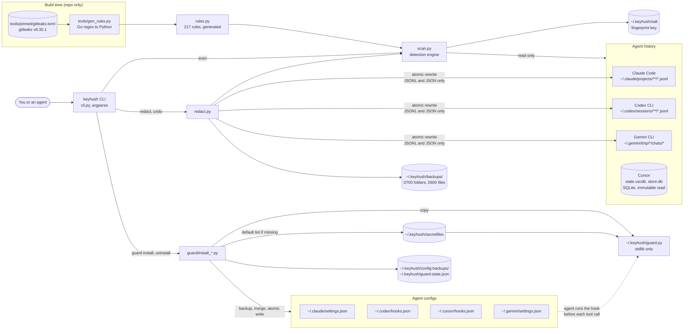
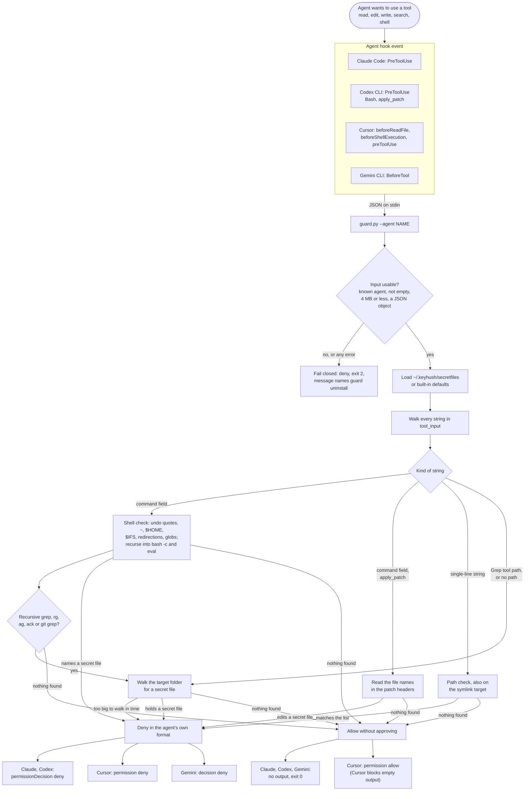
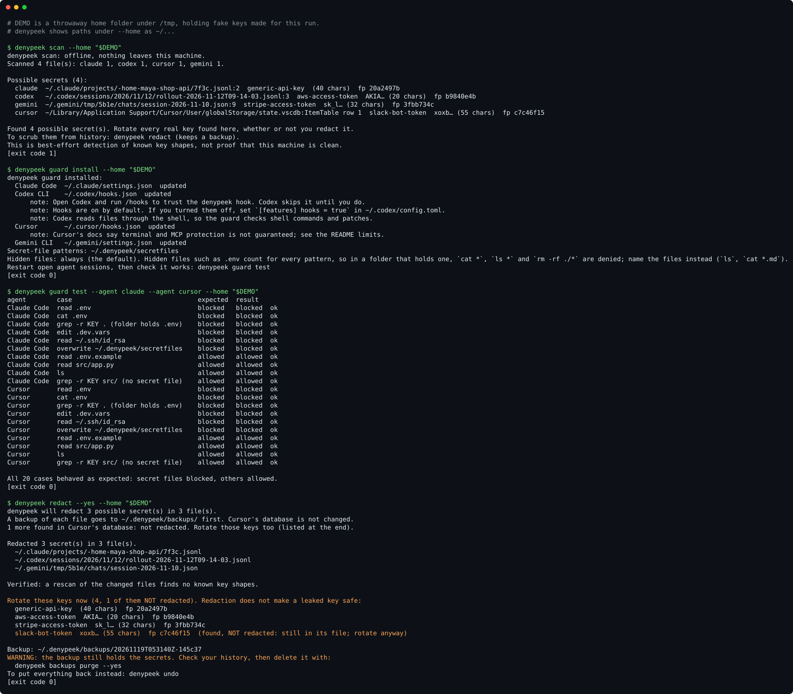

# keyhush

[](https://github.com/Sparli/keyhush/actions/workflows/ci.yml)


**Keep API keys out of your coding agents: block secret-file reads in Claude Code, Codex CLI,
Cursor and Gemini CLI, then find and scrub the keys that already leaked into their history.**

Maya is a freelance developer (made up for this example). Three weeks ago she pasted a GitHub
token into Claude Code to fix a failing deploy. Last week a Codex session ran `cat` on her AWS
config while debugging, and the output landed in its log. Yesterday Cursor's agent opened her
`.env` to "check the Stripe settings". Those keys now sit in plain text in four places on her
laptop, in files she has never opened:

```
~/.claude/projects/-home-maya-shop-api/7f3c.jsonl            line 2   a GitHub token
~/.codex/sessions/2026/11/12/rollout-…jsonl                  line 3   an AWS access key
~/.gemini/tmp/5b1e/chats/session-2026-11-10.json             line 9   a Stripe live key
~/Library/Application Support/Cursor/…/state.vscdb           row 1    a Slack bot token
```

`keyhush scan` finds them without printing them. `keyhush redact` replaces them with markers,
keeps a backup and proves the result with a rescan. `keyhush guard install` stops the next
`.env` read, in all four agents, from one pattern list.

> **Status: v0.1.0, not released.** Guard, scan, redact and undo work and are tested on fixture
> homes in CI and locally. **None of the four agents is live-tested yet**: the hooks follow each
> vendor's documented format, but nobody has run them inside a real Claude Code, Codex CLI,
> Cursor or Gemini CLI session. Not on PyPI. Detection is best effort: a clean scan is not proof
> that a machine is clean.

**The design constraint: nothing leaves your machine.** keyhush has no run-time dependencies and
no network code. It never prints, logs or stores a full secret. The guard is one file of
standard-library Python that each agent runs before a tool call.

## Contents

- [How it works](#how-it-works)
- [Quickstart](#quickstart)
- [Commands](#commands)
- [The guard in each agent](#the-guard-in-each-agent)
- [Scan, rules and redaction](#scan-rules-and-redaction)
- [Design decisions](#design-decisions)
- [Failure modes](#failure-modes)
- [Limitations (honest)](#limitations-honest)
- [Ceilings and upgrade paths](#ceilings-and-upgrade-paths)
- [Roadmap](#roadmap)
- [Use from an agent](#use-from-an-agent)
- [Development](#development)
- [About this project](#about-this-project)

## How it works

### Architecture

<!-- diagram:01-architecture-overview -->

<!-- /diagram -->

**Three jobs share one detection engine and one pattern list, and every write goes through a
backup first.** `scan` only reads. `redact` and `guard install` are the only commands that write
outside `~/.keyhush/`, and both keep a copy of what they change.

| Part | File | Job |
|---|---|---|
| CLI | `src/keyhush/cli.py` | Parses commands with `argparse`. |
| Rules | `src/keyhush/rules.py` | 217 detection rules, generated from gitleaks by `tools/gen_rules.py`. |
| Scanner | `src/keyhush/scan.py`, `sources/` | Finds history files per agent and matches the rules. |
| Redaction | `src/keyhush/redact.py`, `backups.py` | Rewrites JSONL and JSON history, backs up, verifies, undoes. |
| Guard hook | `src/keyhush/guard/guard.py` | The script each agent runs before a tool call. |
| Installers | `src/keyhush/guard/install_*.py` | Edit each agent's config, one module per agent. |

### The guard path

<!-- diagram:02-guard-flow -->

<!-- /diagram -->

How a blocked `.env` read works:

1. **The agent fires its hook.** Before a tool call, the agent runs
   `python3 ~/.keyhush/guard.py --agent NAME` and writes the call to its stdin as JSON. The event
   differs per agent: `PreToolUse` in Claude Code and Codex CLI, `beforeReadFile`,
   `beforeShellExecution` and `preToolUse` in Cursor, `BeforeTool` in Gemini CLI.
2. **The guard checks the input itself.** Unknown agent, empty input, input over 4 MB, broken
   JSON, or anything that raises: the guard denies, exits 2, and names `keyhush guard uninstall`.
   It never fails open.
3. **It loads the pattern list.** `~/.keyhush/secretfiles`, or the built-in defaults when that file
   is missing.
4. **It looks at every string in the tool input**, so it does not depend on each agent's field
   names. A `command` field gets the shell check. An `apply_patch` gets its file headers read. Any
   other single-line string gets the path check.
5. **The shell check undoes common disguises.** Quotes, `~`, `$HOME`, `$IFS`, redirections such as
   `<.env`, globs such as `.e*` (including hidden files), and scripts nested in `bash -c` or
   `eval`. Every token that names a file on the list is a hit.
6. **Recursive search is checked as a whole.** For `grep -r`, `rg`, `ag`, `ack`, `git grep` and the
   agents' own search tools, the guard walks the target folder. If it holds a secret file, or is
   too big to walk in 0.4 seconds, the search is denied.
7. **The answer goes back in the agent's own format.** A deny carries a reason the agent shows.
   An allow says nothing (Cursor gets an explicit `allow`, because it blocks empty output), so the
   agent's own permission prompts still apply.

### Scan, redact and undo

<!-- diagram:03-scan-redact-flow -->

<!-- /diagram -->

## Quickstart

You need Python 3.9 or newer and [uv](https://docs.astral.sh/uv/getting-started/installation/).

```bash
git clone <repository address> keyhush && cd keyhush
```

```bash
uv run keyhush scan
```

That is a read-only scan of your agent history. Exit code 0 means nothing found, 1 means
findings, 2 means something could not be read.

Block secret-file reads in your agents, then prove the hook works:

```bash
uv run keyhush guard install
```

```bash
uv run keyhush guard test
```

Once keyhush is on PyPI, `uvx keyhush scan` will work without cloning. Until then:
`uvx --from git+<repository address> keyhush scan`.

### Example run

Real output from `tools/capture_demo.py`, which builds a throwaway home folder under `/tmp` with
fake keys made at run time and runs the commands against it
([plain text](docs/assets/demo-run.txt)):



## Commands

| Command | What it does |
|---|---|
| `keyhush scan [--json]` | Read-only scan of agent history. Shows rule, file, line, first four characters, length and a fingerprint. |
| `keyhush redact [--yes] [--include-active]` | Replaces each found key with `[REDACTED:<rule>:<fingerprint>]` in JSONL and JSON history, after a backup. Then rescans. |
| `keyhush undo [--set NAME]` | Restores the files changed by the last redact, byte for byte. |
| `keyhush backups list` / `purge --yes` | Lists or deletes redact backups. They still hold the keys. |
| `keyhush guard install [--agent NAME]` | Wires the guard into each agent's own pre-tool hook. |
| `keyhush guard status [--json]` | Shows where it is installed. Exit 0 only if all asked-for agents are covered. |
| `keyhush guard test` | Feeds each agent's real hook input format to the installed hook and prints blocked or allowed, per agent and case. |
| `keyhush guard uninstall [--agent NAME]` | Removes only keyhush's entries. |

Every command takes `--home DIR` to work on another home folder (used for testing).

## The guard in each agent

`guard install` copies `guard.py` to `~/.keyhush/`, writes a default pattern list to
`~/.keyhush/secretfiles` if there is none, and adds a hook entry to each agent. Before each edit it
backs the file up to `~/.keyhush/config-backups/`. It merges without touching your other settings,
writes atomically, and can run twice without duplicates. `uninstall` removes only what it added.

| Agent | File it edits | Hook | Notes |
|---|---|---|---|
| Claude Code | `~/.claude/settings.json` | `PreToolUse` for `Read\|Edit\|Write\|Grep\|Glob\|Bash\|PowerShell`, plus `permissions.deny` `Read(...)` rules | Deny rules also cover `@` mentions, which skip hooks. [Hooks](https://code.claude.com/docs/en/hooks), [permissions](https://code.claude.com/docs/en/permissions) |
| Codex CLI | `~/.codex/hooks.json` | `PreToolUse` for `Bash\|apply_patch` | **Run `/hooks` in Codex and trust the hook. Codex skips it until you do.** Hooks are on by default; if you turned them off, set `[features] hooks = true` in `~/.codex/config.toml`. [Docs](https://learn.chatgpt.com/docs/hooks) |
| Cursor | `~/.cursor/hooks.json` | `beforeReadFile`, `beforeShellExecution`, and `preToolUse` for `Read\|Write\|Grep\|Delete\|Shell`, all with `failClosed: true` | [Docs](https://cursor.com/docs/hooks) |
| Gemini CLI | `~/.gemini/settings.json` | `BeforeTool` for its file, search and shell tools | [Docs](https://geminicli.com/docs/hooks/reference/) |

### The pattern list

`~/.keyhush/secretfiles` uses gitignore-style lines. Case does not matter. A name with no slash
matches at any depth, `~/` means your home folder, and `!` allows a path again. The defaults
include `.env`, `.env.*` (but not `.env.example`, `.env.sample` or `.env.template`),
`.dev.vars`, `*.pem`, `*.key`, `id_rsa*` and other SSH keys (not `*.pub`), `.netrc`, `.npmrc`,
`.pypirc`, `credentials.json`, `~/.aws/credentials`, `~/.ssh/**`, `~/.docker/config.json`,
`~/.kube/config` and `~/.config/gcloud/**`. Edit the file, then run `keyhush guard test`.

## Scan, rules and redaction

### What scan reads

| Agent | Where | Format | Source of the path |
|---|---|---|---|
| Claude Code | `~/.claude/projects/**/*.jsonl` (or `$CLAUDE_CONFIG_DIR`) | JSONL | [Official docs](https://code.claude.com/docs/en/claude-directory) |
| Claude Code | `~/.claude/history.jsonl` | JSONL | **[unverified]** community sources |
| Codex CLI | `~/.codex/sessions/**`, `archived_sessions/`, `history.jsonl` (or `$CODEX_HOME`) | JSONL | **[unverified]** community sources |
| Gemini CLI | `~/.gemini/tmp/*/chats/*`, `logs.json` | JSONL, JSON | **[unverified]** community sources |
| Cursor | `state.vscdb` under Cursor's app folder (macOS, Linux, Windows), `~/.cursor/chats/**/store.db` | SQLite, read-only | **[unverified]** community sources |

Cursor's database is opened in immutable read-only mode: no locks, no journal, and the `-wal` file
is never touched. Every file or line that could not be read (broken JSON, bad UTF-8, no
permission) is listed, and the exit code is 2. A line holding a U+2028 character is read as one
line, not split, and noted. Fingerprints are a keyed hash with a random per-machine salt in
`~/.keyhush/salt`, so a short key cannot be worked back from its fingerprint.

### Detection rules

The rules come from [gitleaks](https://github.com/gitleaks/gitleaks/blob/v8.30.1/config/gitleaks.toml)
v8.30.1 (MIT), converted to Python by `tools/gen_rules.py`, with gitleaks' keywords, entropy
thresholds and allowlists kept. 217 of its 222 rules are used. 26 were rewritten from Go-only
regex syntax. These 5 are not used, because they match on the file's name or type, which does not
apply to agent history:

- `pkcs12-file` (matches file names only)
- `freemius-secret-key`, `hashicorp-tf-password`, `kubernetes-secret-yaml`,
  `nuget-config-password` (only apply to certain file types)

### Redaction, undo and backups

`redact` works on JSONL and JSON history only, never on Cursor's database.

- It asks first (or takes `--yes`) and never runs without confirmation in a non-interactive shell.
- It backs up each file to `~/.keyhush/backups/<time>-<id>/`. Those folders and files are created
  owner-only (0700 and 0600), not beside the original.
- It writes to a temporary file and renames it over the original, so a crash leaves the original
  intact. If the file changed while keyhush worked (an agent writing to it), that file is skipped.
- It skips files changed in the last 10 minutes unless you pass `--include-active`. It also skips
  symlinks that lead outside the history folders and files with other hard links.
- Untouched lines stay byte-identical. A changed line must still be valid JSON, or it is left
  alone and listed.
- It rescans the changed files, says whether anything is left, and lists the keys to rotate.

**The backups still hold the keys.** Check your history, then run `keyhush backups purge --yes`.

## Design decisions

**No dependencies, `argparse` instead of Typer.** A tool that reads your secrets should not pull
in a supply chain, and the hook must start fast inside every tool call. Rejected: Typer and Rich
for nicer output, and calling the gitleaks Go binary, which would need a second install.

**Reuse gitleaks' rules, generated, not hand-copied.** gitleaks' rule file is MIT and maintained
by people who track key formats. `tools/gen_rules.py` converts it from a pinned, hash-checked copy,
and a test fails if `rules.py` drifts. Rejected: trufflehog (AGPL, and its live-key checks send
keys to third parties), and writing our own rules.

**The hook fails closed.** If the guard cannot read its input or crashes, it denies the call and
says how to uninstall it. A guard that fails open is skipped exactly when something odd happens.
Codex lets a tool run on a hook error, so the guard always answers with a proper deny rather than
crashing. Rejected: fail open with a warning.

**Allow by saying nothing.** On a harmless call the guard returns no decision, so the agent's own
permission prompts still run. Returning "allow" would have approved calls the user is normally
asked about. Cursor is the exception: it blocks empty output, so it gets an explicit allow.

**Check every string, not named fields.** Hook input formats differ per agent and change between
versions. The guard checks every string in the tool input, so a renamed field does not open a
hole. Rejected: one parser per tool and field name.

**Backups away from the history, owner-only from the start.** Files are created with 0600 and
folders with 0700, never loosened and then fixed. They live under `~/.keyhush/backups/`, not as
`.bak` files beside the original, where an agent or a sync tool would pick them up. Rejected:
in-place `.bak` files.

## Failure modes

| What goes wrong | What keyhush does |
|---|---|
| The guard gets empty, broken or huge input, or crashes | Denies, exits 2, names `keyhush guard uninstall`. |
| A grep targets a folder too big to walk in 0.4 seconds | Denies and asks for a narrower path. |
| An agent config is not valid JSON, too big, or has an unexpected type | `guard install` leaves that file untouched, reports it, and still installs the others. Exit code 2. |
| `~/.keyhush/secretfiles` is missing | The guard uses its built-in defaults. |
| A history line is broken JSON or bad UTF-8 | Scanned as text where possible, listed as not fully checked, exit code 2. |
| A history file cannot be read | Listed, exit code 2. Never silently skipped. |
| An agent writes to a file during `redact` | The change is detected before the rename; that file is left alone and listed. |
| The machine crashes mid-redact | The original stays intact: changes go to a temp file that is renamed over it. |
| A redacted line would stop being valid JSON | That line is left as is and listed. |
| A file changed after `redact` | `undo` refuses to overwrite it and lists it. |
| A backup copy is damaged | `undo` checks its hash and refuses to restore it. |
| `redact` runs in a script without `--yes` | It refuses and changes nothing. |

## Limitations (honest)

- **Not live-tested in any agent.** Claude Code, Codex CLI, Cursor and Gemini CLI are all "not
  live-tested" so far. The hooks follow each vendor's documented format and pass `guard test`
  on fixtures.
- **The guard is a heuristic.** It cannot stop a script that opens a file itself
  (`python -c "open('.env')"`), MCP tools, or a user who approves a read the hook did not see. The
  shell check will miss some tricks.
- **Cursor:** Cursor's own docs say terminal and MCP protection is not guaranteed. Whether Cursor's
  own approval prompt still appears after the guard's `allow` on a shell command is not documented.
- **Codex:** the hook does nothing until you trust it with `/hooks`. Codex lets a tool run if a
  hook errors or times out; keyhush always answers to avoid that.
- **Grep:** the guard blocks a search over any folder that holds a secret file, including the
  agent's own search tool over your whole project. Narrow the path (for example `src/`) to search.
- **Hook inputs over 4 MB are blocked** rather than checked. Cursor sends a file's contents with
  each read, so reading a file over 4 MB in Cursor is blocked.
- **Paths:** history locations for Codex, Gemini CLI, Cursor and Claude's `history.jsonl` come
  from community sources, not vendor docs. Windows paths are unverified. Windows is tested on
  fixtures in CI only.
- **Labels:** when a generic rule and a specific rule match the same text, the generic label can
  win. The example run shows a GitHub token labelled `generic-api-key`. The key is still found.
- **Speed:** very long history lines packed with key-like words scan slowly, about 7 seconds per
  400 KB in our worst-case test.
- Secrets with no known shape, and secrets split across messages, are not found.
- **Redaction changes your history files**, and the backups hold the secrets until you purge them.
- **A found key must be rotated**, whether or not you redact it. It may already have been sent to
  the agent's provider.
- Best-effort detection: a clean result is not proof that a machine is clean.

## Ceilings and upgrade paths

| Area | Today | Where it stops | What would lift it |
|---|---|---|---|
| Agents | Claude Code, Codex CLI, Cursor, Gemini CLI | Any other agent | One `install_<agent>.py` module and its sample inputs in `guard test`. |
| Hook input | Up to 4 MB, parsed whole | Larger inputs are blocked | Check only the tool name and path fields of big inputs before parsing the rest. |
| Folder search check | 20,000 entries or 0.4 seconds | Bigger folders are denied | A cached index of secret-file locations per project. |
| Scan speed | Whole-line regex with a keyword prefilter | Seconds per MB on dense lines | Run each rule only on a window around its keyword hit. |
| Redaction | JSONL and JSON | Cursor's SQLite is read only | A SQLite writer that takes Cursor's lock and handles its WAL, once the schema is verified. |
| Detection | Known key shapes | Unknown shapes, split secrets | Optional entropy-only mode, with its false-positive rate measured first. |

## Roadmap

| Version | Adds |
|---|---|
| **v0.1** | Guard for four agents with `guard test`, scan, redact with verify and undo, offline tests, CI on three systems |
| v0.2 | Fixes from QA and security review, live tests in each agent, Claude Code plugin, MCP server |
| later | More agents, faster scan on large histories, verified Windows paths |

## Use from an agent

`skills/keyhush/SKILL.md` is a skill file for Claude Code, Codex, Cursor and Gemini CLI.
`AGENTS-snippet.md` is a block to paste into `AGENTS.md`. Both tell the agent to run
`keyhush scan --json` and `keyhush guard status`, and never `keyhush redact` without your yes.

## Development

```bash
uv sync
```

```bash
uv run pytest
```

```bash
uv run ruff check .
```

Tests build fixture homes in a temp folder, assemble fake keys at run time, disable the network,
and fail if anything touches your real home folder. `python tools/gen_rules.py --check` confirms
`rules.py` matches the pinned gitleaks file. Design notes are in [`specs/`](specs/), diagrams in
[`diagrams/`](diagrams/). See [CONTRIBUTING.md](CONTRIBUTING.md) and
[CHANGELOG.md](CHANGELOG.md).

## About this project

keyhush is a small open-source tool from Sparli Aman's studio. It builds on gitleaks' rules and on
the hook systems the four agent vendors document, and it was made with AI-assisted tooling; every
design choice is written down above and in `specs/`. Maya and her keys are made up.

Licence: MIT. The licence file will be added before the first release. Third-party notices are in
[THIRD_PARTY.md](THIRD_PARTY.md). Security reports: see [SECURITY.md](SECURITY.md).
